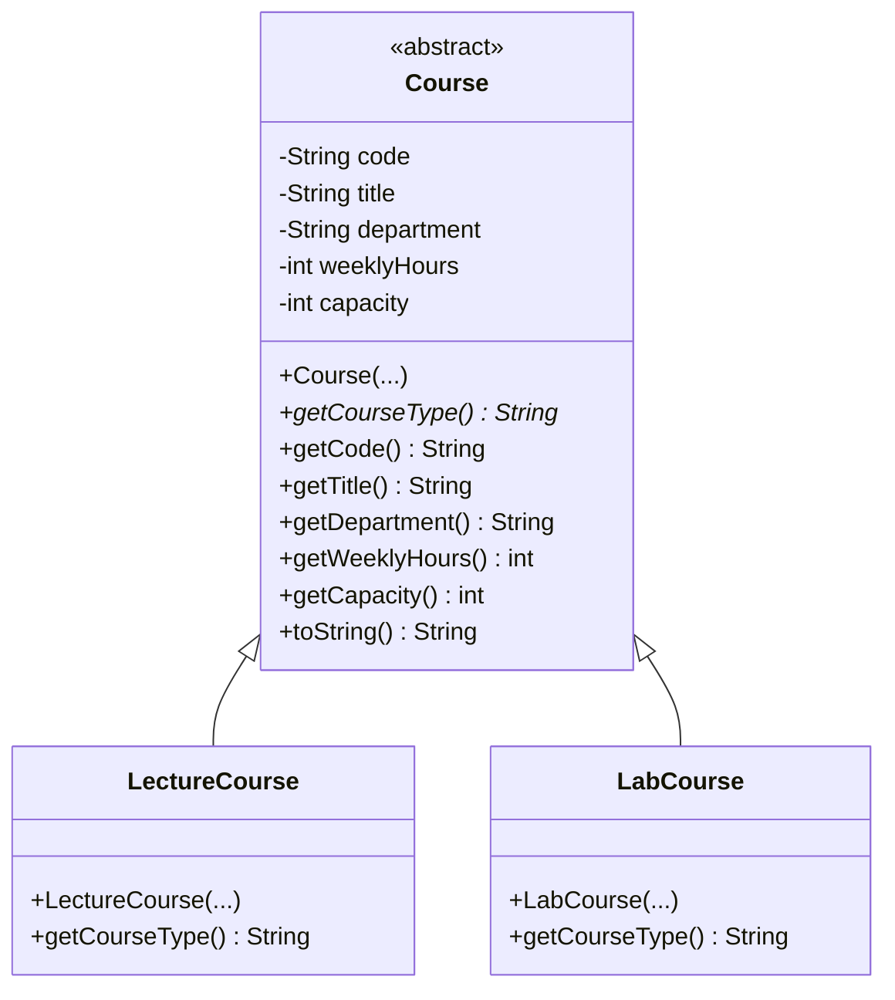
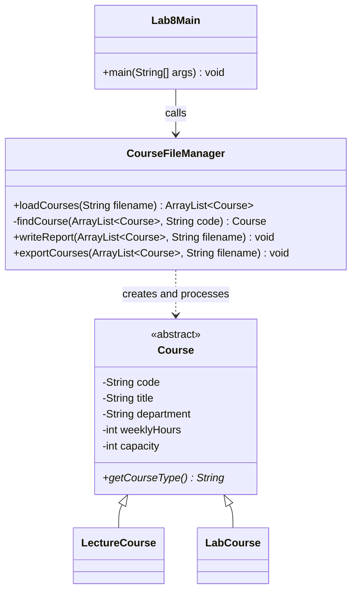
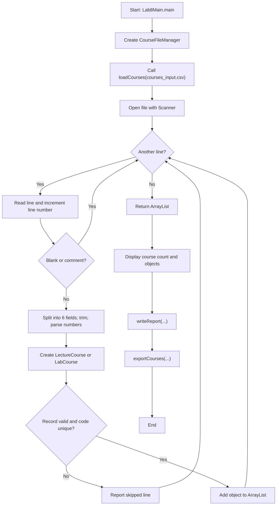

# Programming 2 — Lecture 13: File I/O in Java
## Reading, validating, creating objects, and writing files — preparing for Lab 8

**This lecture combines the former Lecture 13 (TextIO Input) and Lecture 14 (TextIO Output).**

---

## Learning objectives

By the end of this lecture, you should be able to:

- explain why a program needs files in addition to in-memory collections;
- read a text file line by line using `Scanner`;
- understand relative file paths and the working directory;
- split a CSV-style record into fields and validate the fields;
- convert text into numeric values safely;
- create objects from file records using inheritance and polymorphism;
- distinguish a malformed record from a file-level error;
- write a human-readable report and a structured CSV export using `FileWriter`;
- distinguish overwrite mode from append mode;
- use try-with-resources for both reading and writing;
- explain how `Lab8Main`, `CourseFileManager`, and the course classes work together.

## 1. Why do we need File I/O?

In Assignment 3, you used collections such as `ArrayList`, `HashSet`, and `HashMap` to store and organize objects. These collections are useful, but their contents normally exist only while the program is running.

When the program terminates, the objects in memory disappear. If the college needs the course catalogue the next time the program starts, the information must be stored outside the running program.

**File I/O** means transferring information between a Java program and files.

```text
INPUT:   text file  ─────► Java program
OUTPUT:  Java program ───► text file
```

For Lab 8, the complete workflow is:

```text
courses_input.csv
       |
       v
Read one line at a time
       |
       v
Split line into fields
       |
       v
Validate and convert fields
       |
       v
Create LectureCourse or LabCourse
       |
       v
Store objects in ArrayList<Course>
       |
       +-----------------------------+
       |                             |
       v                             v
Human-readable report          Structured CSV export
courses_report.txt             courses_export.csv
```

The important idea is that the program does not simply copy text from one file to another. It reads the text, interprets it, creates Java objects, and then uses those objects to produce new output files.

## 2. The Lab 8 course model

Before examining file operations, understand the objects that will be created from the input file.

The class hierarchy is deliberately small:



- `Course` is the abstract superclass. It stores information shared by all courses.
- `LectureCourse` inherits from `Course` and returns `"Lecture"` from `getCourseType()`.
- `LabCourse` inherits from `Course` and returns `"Lab"` from `getCourseType()`.

The collection used in the lab is:

```java
ArrayList<Course> courses = new ArrayList<>();
```

This one list can hold both `LectureCourse` and `LabCourse` objects because both are subclasses of `Course`.

That is inheritance and polymorphism working together. The file-loading code decides which concrete object to construct. Later code can process every object through a `Course` reference.

### Important details in the teacher solution

The Lab 8 IntelliJ solution uses `final` fields in `Course`. The course information is validated in the constructor and then cannot be reassigned.

```java
private final String code;
private final String title;
private final String department;
private final int weeklyHours;
private final int capacity;
```

The constructor rejects:

- a missing or blank course code, title, or department;
- a weekly-hours value that is zero or negative;
- a capacity value that is zero or negative.

The constructor throws `IllegalArgumentException` when the supplied data is invalid. The file-reading method will handle that exception as a problem with the current record.

## 3. Understanding the input file

The supplied `courses_input.csv` contains:

```text
# type,code,title,department,hours,capacity
LECTURE,420-SN1,Programming in Science,CST,3,30
LAB,420-LA1,Programming Lab,CST,2,24
LECTURE,420-DB1,Database Fundamentals,CST,3,28
LAB,420-NW1,Networking Lab,CST,2,20
LECTURE,420-XX1,Invalid Hours,CST,three,25
```

The first line is a comment describing the fields. Each remaining line represents one course record.

The fields have a fixed meaning:

| Array position | Meaning | Example |
|---|---|---|
| `fields[0]` | Course type | `LECTURE` |
| `fields[1]` | Course code | `420-SN1` |
| `fields[2]` | Course title | `Programming in Science` |
| `fields[3]` | Department | `CST` |
| `fields[4]` | Weekly hours | `3` |
| `fields[5]` | Capacity | `30` |

At this point, a record is only a `String`. Java does not yet know that `"3"` should become an integer or that the line represents a `LectureCourse`.

The program must parse and validate the record before creating an object.

**CSV limitation in this lab:** Assume course titles and department names do not contain commas. A production CSV parser must also handle quoted fields, escaped quotes, and commas inside quoted values. That is outside the scope of Lab 8.

## 4. Reading a file with `Scanner`

A simple way to read a text file is to create a `File` object and pass it to a `Scanner`.

```java
import java.io.File;
import java.io.FileNotFoundException;
import java.util.Scanner;

File file = new File("courses_input.csv");

try (Scanner input = new Scanner(file)) {
    while (input.hasNextLine()) {
        String line = input.nextLine();
        System.out.println(line);
    }
}
catch (FileNotFoundException e) {
    System.out.println("Input file could not be found.");
}
```

Understand the important statements:

```java
File file = new File("courses_input.csv");
```

This represents the file path. It does not read the file by itself.

```java
Scanner input = new Scanner(file);
```

This opens the file for reading.

```java
while (input.hasNextLine())
```

This checks whether another line is available.

```java
String line = input.nextLine();
```

This reads the next complete line as a `String`.

### Why use try-with-resources?

```java
try (Scanner input = new Scanner(file)) {
    // read the file
}
```

The `Scanner` is a resource. It should be closed after reading. Try-with-resources closes it automatically when the block finishes, including when an exception occurs.

The same pattern will be used later when writing with `FileWriter`.

## 5. Relative paths and IntelliJ's working directory

Lab 8 opens the input file like this:

```java
new File("courses_input.csv")
```

This is a **relative path**. It means Java looks for `courses_input.csv` relative to the program's working directory.

Do not assume that the working directory is automatically the folder containing the `.java` file.

The IntelliJ project should have this structure:

```text
Lab8_IntelliJ_Ready/
|
+-- src/
|   +-- Course.java
|   +-- LectureCourse.java
|   +-- LabCourse.java
|   +-- CourseFileManager.java
|   +-- Lab8Main.java
|
+-- courses_input.csv
+-- README_IntelliJ.md
```

The input CSV is in the project root, beside the `src` folder.

If Java reports that the input file cannot be found:

1. Confirm that `courses_input.csv` exists.
2. Confirm that the spelling and capitalization match.
3. Check IntelliJ's run configuration.
4. Set the **Working directory** to the project root — the folder containing `courses_input.csv`.

In IntelliJ, open **Run → Edit Configurations** and inspect the Working directory field.

A useful debugging statement is:

```java
System.out.println(System.getProperty("user.dir"));
```

It prints the current working directory.

## 6. Process the file one record at a time

The core reading loop in `CourseFileManager.loadCourses` is:

```java
int lineNumber = 0;

while (input.hasNextLine()) {
    String line = input.nextLine();
    lineNumber++;

    // process this line
}
```

The program reads one line, increments the line counter, and then processes that record. Keeping the line number helps produce a useful error message if a record is invalid.

### 6.1 Ignore blank lines and comments

The solution uses:

```java
line = line.trim();

if (line.isEmpty() || line.startsWith("#")) {
    continue;
}
```

- `trim()` removes spaces at the beginning and end of the line.
- `isEmpty()` checks whether nothing remains.
- `startsWith("#")` identifies a comment line.
- `continue` skips the rest of the current loop iteration and moves to the next line.

Comments and blank lines are not course records, so they should not be parsed.

### 6.2 Split a record into fields

The solution uses:

```java
String[] fields = line.split(",", -1);
```

For this record:

```text
LECTURE,420-SN1,Programming in Science,CST,3,30
```

the resulting array contains:

```text
fields[0] = "LECTURE"
fields[1] = "420-SN1"
fields[2] = "Programming in Science"
fields[3] = "CST"
fields[4] = "3"
fields[5] = "30"
```

Why use `split(",", -1)` rather than just `split(",")`?

The negative limit preserves trailing empty fields. Consider:

```text
LECTURE,420-SN1,Programming in Science,CST,3,
```

The capacity is missing. With the `-1` limit, the final empty field remains in the array, allowing the program to detect that the record still has six fields but the last value is empty. Without the negative limit, trailing empty fields may be discarded.

### 6.3 Check the number of fields

The input format requires exactly six fields:

```java
if (fields.length != 6) {
    throw new IllegalArgumentException(
            "Expected 6 fields but found " + fields.length);
}
```

This prevents the program from trying to access a field that does not exist.

### 6.4 Trim each field

A record may contain unnecessary spaces:

```text
LECTURE, 420-SN1 , Programming in Science , CST , 3 , 30
```

Trim each field before using it:

```java
String type = fields[0].trim();
String code = fields[1].trim();
String title = fields[2].trim();
String department = fields[3].trim();
```

This keeps accidental spaces from becoming part of the stored data.

## 7. Convert text into numbers

The file stores every field as text. Weekly hours and capacity must become integers.

```java
int hours = Integer.parseInt(fields[4].trim());
int capacity = Integer.parseInt(fields[5].trim());
```

`Integer.parseInt` converts a string such as `"3"` into the integer `3`.

But what happens if the file contains:

```text
LECTURE,420-XX1,Invalid Hours,CST,three,25
```

This statement:

```java
Integer.parseInt("three");
```

throws a `NumberFormatException`, because `"three"` is not a valid integer representation.

`NumberFormatException` is a subclass of `IllegalArgumentException`. The Lab 8 solution catches `IllegalArgumentException` around the processing of each individual record.

This is why validation and exception handling are important when reading external data. A file may contain missing, malformed, or unexpected values.

## 8. Create the correct object using inheritance and polymorphism

After the fields have been extracted and converted, the program must decide which class to instantiate.

The solution uses:

```java
Course course;

if (type.equalsIgnoreCase("LECTURE")) {
    course = new LectureCourse(
            code, title, department, hours, capacity);
}
else if (type.equalsIgnoreCase("LAB")) {
    course = new LabCourse(
            code, title, department, hours, capacity);
}
else {
    throw new IllegalArgumentException(
            "Unknown course type: " + type);
}
```

Notice the variable declaration:

```java
Course course;
```

The variable has the superclass type, but it can refer to an instance of either subclass.

For example:

```java
Course first = new LectureCourse(
        "420-SN1", "Programming in Science", "CST", 3, 30);

Course second = new LabCourse(
        "420-LA1", "Programming Lab", "CST", 2, 24);
```

Both objects can be stored in:

```java
ArrayList<Course> courses = new ArrayList<>();
```

Later, the program can loop through the list without asking whether every object is a lecture or a lab. When it calls an overridden method such as `getCourseType()`, Java executes the version belonging to the actual object.

### What if the type is not recognized?

If the first field is neither `LECTURE` nor `LAB`, the solution throws an `IllegalArgumentException`. That record is invalid and will be reported and skipped.

## 9. Reject duplicate course codes

The IntelliJ teacher solution includes an additional validation step: it rejects duplicate course codes, ignoring letter case.

```java
if (findCourse(courses, code) != null) {
    throw new IllegalArgumentException(
            "Duplicate course code: " + code);
}

courses.add(course);
```

The helper method searches the courses already loaded:

```java
private Course findCourse(ArrayList<Course> courses, String code) {
    for (Course course : courses) {
        if (course.getCode().equalsIgnoreCase(code)) {
            return course;
        }
    }
    return null;
}
```

- If a course with that code already exists, the method returns the matching object.
- If no matching code exists, it returns `null`.
- `equalsIgnoreCase` means `420-SN1` and `420-sn1` are treated as the same code.

This prevents duplicate course records from being added to the list.

## 10. Handle malformed records separately from file errors

This is one of the most important design decisions in Lab 8.

There are two different kinds of problems:

### A. A malformed record

Examples:

- the record has the wrong number of fields;
- the hours field contains `"three"` instead of a number;
- the course type is unknown;
- required information is blank;
- hours or capacity are not positive;
- the course code is duplicated.

These are problems with one individual record. The solution reports the problem and continues reading the remaining lines.

The record-processing code is inside:

```java
try {
    // split, validate, parse, create the object,
    // check duplicate code, and add the course
}
catch (IllegalArgumentException ex) {
    System.err.println("Skipped line " + lineNumber
            + ": " + ex.getMessage() + " | " + line);
}
```

The catch block is **inside the while loop**. This placement matters: after reporting one invalid record, execution returns to the loop and reads the next line.

### B. A file-level error

Examples:

- the input file does not exist;
- the program cannot open the file;
- a file operation fails.

These are not problems with one row. The file itself cannot be read successfully.

The method signature is:

```java
public ArrayList<Course> loadCourses(String filename)
        throws IOException
```

The `IOException` is allowed to propagate to the caller. `Lab8Main` catches it and displays a message.

### Compare the two designs

| Malformed record | File-level error |
|---|---|
| One row contains invalid data | File cannot be opened or read |
| Caught inside the reading loop | Propagated to `Lab8Main` |
| Report the line and continue | Report the file operation failure |
| Other valid rows can still load | The requested load operation cannot complete |

Do not catch every possible exception and silently ignore it. The program should report what went wrong and handle it at the appropriate level.

## 11. The complete `loadCourses` method

The following is the core method from the Lab 8 teacher solution. Read it in stages: opening the file, reading each line, validating fields, creating the object, checking for duplicates, and adding the object.

```java
public ArrayList<Course> loadCourses(String filename) throws IOException {
    ArrayList<Course> courses = new ArrayList<>();
    File file = new File(filename);

    try (Scanner input = new Scanner(file)) {
        int lineNumber = 0;

        while (input.hasNextLine()) {
            String line = input.nextLine();
            lineNumber++;

            line = line.trim();
            if (line.isEmpty() || line.startsWith("#")) {
                continue;
            }

            try {
                String[] fields = line.split(",", -1);
                if (fields.length != 6) {
                    throw new IllegalArgumentException(
                            "Expected 6 fields but found " + fields.length);
                }

                String type = fields[0].trim();
                String code = fields[1].trim();
                String title = fields[2].trim();
                String department = fields[3].trim();
                int hours = Integer.parseInt(fields[4].trim());
                int capacity = Integer.parseInt(fields[5].trim());

                Course course;
                if (type.equalsIgnoreCase("LECTURE")) {
                    course = new LectureCourse(
                            code, title, department, hours, capacity);
                } else if (type.equalsIgnoreCase("LAB")) {
                    course = new LabCourse(
                            code, title, department, hours, capacity);
                } else {
                    throw new IllegalArgumentException(
                            "Unknown course type: " + type);
                }

                if (findCourse(courses, code) != null) {
                    throw new IllegalArgumentException(
                            "Duplicate course code: " + code);
                }

                courses.add(course);
            } catch (IllegalArgumentException ex) {
                System.err.println("Skipped line " + lineNumber
                        + ": " + ex.getMessage() + " | " + line);
            }
        }
    }

    return courses;
}
```

### Trace one valid record

For:

```text
LECTURE,420-SN1,Programming in Science,CST,3,30
```

the method:

1. reads the line;
2. splits it into six fields;
3. trims the fields;
4. converts `"3"` and `"30"` into integers;
5. recognizes the type as `LECTURE`;
6. creates a `LectureCourse`;
7. checks that `420-SN1` is not already in the list;
8. adds the object to `ArrayList<Course>`.

### Trace the invalid record

For:

```text
LECTURE,420-XX1,Invalid Hours,CST,three,25
```

the method reaches:

```java
int hours = Integer.parseInt(fields[4].trim());
```

This throws `NumberFormatException`. Because it is an `IllegalArgumentException`, the inner catch block handles it. The program reports line 6 and continues. The invalid object is never created or added to the list.

## 12. Writing files with `FileWriter`

Reading transfers information from a file into the program. Writing transfers information from the program into a file.

```text
File ──► Java objects       (input)
Java objects ──► File       (output)
```

A basic example:

```java
import java.io.FileWriter;
import java.io.IOException;

try (FileWriter writer = new FileWriter("report.txt")) {
    writer.write("Hello\n");
    writer.write("Programming 2\n");
}
catch (IOException e) {
    System.out.println("Could not write file: " + e.getMessage());
}
```

Important details:

- `FileWriter` opens a file for writing.
- `write(...)` writes characters.
- `\n` adds a line break.
- try-with-resources closes the writer automatically.
- `IOException` represents a file operation problem.

## 13. Overwrite mode versus append mode

These two constructors have different behavior.

### Overwrite mode

```java
new FileWriter(filename)
```

This is the mode used by Lab 8. It normally replaces the existing file contents. If the file already exists, its old contents are overwritten.

### Append mode

```java
new FileWriter(filename, true)
```

The `true` argument enables append mode. New output is added to the end of the existing file.

Example:

```java
try (FileWriter writer = new FileWriter("activity.txt", true)) {
    writer.write("A new activity was recorded.\n");
}
```

### Why does Lab 8 use overwrite mode?

Each run should create a fresh report and export based on the courses loaded during that run. If append mode were used, old results could remain and repeated runs could duplicate records.

Always select the mode that matches the requirement. Do not use append mode automatically.

## 14. Create a human-readable report

Lab 8 creates `courses_report.txt`. This file is designed for a person to read.

Example:

```text
COLLEGE COURSE CATALOGUE
========================
Courses loaded: 4

Code: 420-SN1
Title: Programming in Science
Department: CST
Type: Lecture
Weekly hours: 3
Capacity: 30
------------------------
Code: 420-LA1
Title: Programming Lab
Department: CST
Type: Lab
Weekly hours: 2
Capacity: 24
------------------------
```

The `writeReport` method in `CourseFileManager` is:

```java
public void writeReport(ArrayList<Course> courses, String filename)
        throws IOException {
    try (FileWriter writer = new FileWriter(filename)) {
        writer.write("COLLEGE COURSE CATALOGUE\n");
        writer.write("========================\n");
        writer.write("Courses loaded: " + courses.size() + "\n\n");

        for (Course course : courses) {
            writer.write("Code: " + course.getCode() + "\n");
            writer.write("Title: " + course.getTitle() + "\n");
            writer.write("Department: " + course.getDepartment() + "\n");
            writer.write("Type: " + course.getCourseType() + "\n");
            writer.write("Weekly hours: " + course.getWeeklyHours() + "\n");
            writer.write("Capacity: " + course.getCapacity() + "\n");
            writer.write("------------------------\n");
        }
    }
}
```

### Understand the loop and polymorphism

```java
for (Course course : courses) {
    writer.write("Type: " + course.getCourseType() + "\n");
}
```

The variable `course` is declared as type `Course`. At runtime it refers to a `LectureCourse` or a `LabCourse` object. Java calls the overridden `getCourseType()` method belonging to the actual object.

The output method does not need a separate `if` statement to determine the type of every course. Polymorphism handles that.

## 15. Create a structured CSV export

Lab 8 also creates `courses_export.csv`. This file is intended to store data in a predictable format that another program can read.

The field order is:

```text
type,code,title,department,hours,capacity
```

Example:

```text
# type,code,title,department,hours,capacity
LECTURE,420-SN1,Programming in Science,CST,3,30
LAB,420-LA1,Programming Lab,CST,2,24
LECTURE,420-DB1,Database Fundamentals,CST,3,28
LAB,420-NW1,Networking Lab,CST,2,20
```

The export method is:

```java
public void exportCourses(ArrayList<Course> courses, String filename)
        throws IOException {
    try (FileWriter writer = new FileWriter(filename)) {
        writer.write("# type,code,title,department,hours,capacity\n");

        for (Course course : courses) {
            writer.write(course.getCourseType().toUpperCase() + ","
                    + course.getCode() + ","
                    + course.getTitle() + ","
                    + course.getDepartment() + ","
                    + course.getWeeklyHours() + ","
                    + course.getCapacity() + "\n");
        }
    }
}
```

Notice that the type is written in uppercase (`LECTURE` or `LAB`). This matches the values expected by the input method.

### Why write the type field?

When the CSV is read again, the first field tells the program which concrete class to create. If the type field were omitted, the program would not know whether to construct a `LectureCourse` or `LabCourse`.

### Why not write `course.toString()`?

`toString()` is normally intended as a readable representation for display or debugging. It is not automatically a stable, reversible data format.

For persistent data, write the fields explicitly in the agreed order. This makes the file structure clear and predictable.

## 16. Human-readable report versus structured CSV

Both output files contain information about the same objects, but they serve different purposes.

| Human-readable report | Structured CSV export |
|---|---|
| Designed for people | Designed for consistent parsing |
| Uses labels and headings | Uses a fixed field order |
| Easier to read as a report | Easier for another program to process |
| May include separators and blank lines | Each record is represented as one row |

A report might say:

```text
Type: Lecture
Weekly hours: 3
Capacity: 30
```

The CSV representation is:

```text
LECTURE,420-SN1,Programming in Science,CST,3,30
```

Do not confuse a report format with a data format.

## 17. The complete Lab 8 program architecture

The classes have separate responsibilities.



### Responsibility of each class

| Class | Responsibility |
|---|---|
| `Lab8Main` | Coordinates the application: calls the file manager, displays loaded objects, and handles `IOException`. |
| `CourseFileManager` | Owns file input and output, parsing, record validation, duplicate checking, and report/export generation. |
| `Course` | Stores common course data and validates the constructor arguments. |
| `LectureCourse` | Represents a lecture course and supplies its course type. |
| `LabCourse` | Represents a lab course and supplies its course type. |

The file manager is separate from the model classes. `Course` should not need to know how to open a CSV file. `Lab8Main` should not contain all the parsing and writing details.

This separation makes the program easier to understand, test, maintain, and extend.

## 18. How `Lab8Main` coordinates the work

The `main` method creates a file manager and asks it to perform the file operations.

```java
public static void main(String[] args) {
    CourseFileManager fileManager = new CourseFileManager();

    try {
        ArrayList<Course> courses =
                fileManager.loadCourses("courses_input.csv");

        System.out.println("Successfully loaded courses: " + courses.size());

        for (Course course : courses) {
            System.out.println(course);
        }

        fileManager.writeReport(courses, "courses_report.txt");
        fileManager.exportCourses(courses, "courses_export.csv");

    } catch (IOException ex) {
        System.out.println("File operation failed: " + ex.getMessage());
    }
}
```

The sequence is:

1. Create a `CourseFileManager`.
2. Call `loadCourses` to read and construct the course objects.
3. Receive an `ArrayList<Course>` containing the valid objects.
4. Display the count and the objects.
5. Call `writeReport`.
6. Call `exportCourses`.
7. Catch a file-level `IOException` if a file operation fails.

The actual Lab 8 solution also prints a formatted table header and confirmation messages after generating the output files.

### Full application flow



A file-level `IOException` can interrupt the operation and is handled by the `catch` block in `Lab8Main`.

## 19. Expected Lab 8 result

With the supplied input file, four courses should load successfully. The fifth data record is invalid because the hours value is `"three"` rather than an integer.

The program should report a message similar to:

```text
Skipped line 6: For input string: "three" | LECTURE,420-XX1,Invalid Hours,CST,three,25
```

It should then continue and display four valid courses:

```text
Successfully loaded courses: 4

CODE         TITLE                       DEPT     TYPE     HRS CAPACITY
420-SN1      Programming in Science      CST      Lecture   3  30
420-LA1      Programming Lab             CST      Lab       2  24
420-DB1      Database Fundamentals       CST      Lecture   3  28
420-NW1      Networking Lab              CST      Lab       2  20

Created courses_report.txt
Created courses_export.csv
```

The exact spacing can depend on the console, but the important results are:

- four valid course objects are loaded;
- both subclasses are represented;
- the malformed record is reported and skipped;
- the program continues instead of crashing;
- both output files are generated.

## 20. Run the Lab 8 solution in IntelliJ IDEA

The teacher solution is organized as a small Java project:

```text
Lab8_IntelliJ_Ready/
|
+-- src/
|   +-- Course.java
|   +-- LectureCourse.java
|   +-- LabCourse.java
|   +-- CourseFileManager.java
|   +-- Lab8Main.java
|
+-- courses_input.csv
+-- README_IntelliJ.md
```

### Steps

1. Extract `Lab8_IntelliJ_Ready.zip`.
2. In IntelliJ IDEA, choose **File → Open**.
3. Select the extracted `Lab8_IntelliJ_Ready` folder.
4. Configure a Project SDK. Java 8 or later is supported.
5. Open `src/Lab8Main.java`.
6. Click the green Run icon beside `main`, or right-click the file and select **Run 'Lab8Main.main()'**.
7. If the input file cannot be found, open **Run → Edit Configurations** and set the Working directory to the project root — the folder containing `courses_input.csv`.

No Maven, Gradle, external libraries, or package setup is required.

The program creates these files in the project root:

- `courses_report.txt`
- `courses_export.csv`

### Optional terminal compilation

From the project root:

```bash
javac -Xlint:all -d out src/*.java
java -cp out Lab8Main
```

The supplied teacher solution has been compiled and run successfully with the provided input file. It is compatible with Java 8 or later.

## 21. Common mistakes and how to avoid them

| Mistake | Why it causes a problem | Better approach |
|---|---|---|
| Putting the CSV in `src` without changing the path | The working directory may be the project root | Keep the CSV in the project root or configure the path deliberately |
| Using `next()` instead of `nextLine()` | `next()` reads only a token, not the full record | Use `hasNextLine()` and `nextLine()` |
| Forgetting to trim fields | Spaces may become part of stored values | Call `trim()` on each field |
| Parsing before checking the field count | A missing field can cause an array-index error | Check `fields.length` first |
| Assuming every numeric string is valid | `parseInt` can throw `NumberFormatException` | Handle malformed records |
| Catching the record exception outside the loop | One bad row can stop processing the remaining rows | Catch `IllegalArgumentException` inside the loop |
| Catching and ignoring all exceptions | Real file problems can be hidden | Handle malformed records and file-level errors separately |
| Writing `toString()` as CSV | Display formatting is not a defined data format | Write each field explicitly |
| Using append mode unintentionally | Repeated runs can duplicate old output | Use overwrite mode when a fresh report is required |
| Forgetting try-with-resources | File resources may remain open | Use try-with-resources for `Scanner` and `FileWriter` |

## 22. Practice questions

### Practice 1 — Reading

What is the difference between these two statements?

```java
input.hasNextLine();
input.nextLine();
```

**Answer:** `hasNextLine()` checks whether another line is available. `nextLine()` reads and returns that line.

### Practice 2 — Parsing

Why does Lab 8 use:

```java
line.split(",", -1);
```

**Answer:** It splits the line at commas and preserves trailing empty fields, allowing missing final values to be detected.

### Practice 3 — Exceptions

The input contains:

```text
LECTURE,420-XX1,Invalid Hours,CST,three,25
```

Which statement causes the exception?

**Answer:**

```java
Integer.parseInt(fields[4].trim());
```

It throws `NumberFormatException` because `"three"` is not a valid integer.

### Practice 4 — Exception placement

Why is the `catch (IllegalArgumentException ex)` block inside the `while` loop?

**Answer:** So the program can report and skip one invalid record, then continue processing the next line.

### Practice 5 — Object creation

Why can this list store both lecture and lab courses?

```java
ArrayList<Course> courses = new ArrayList<>();
```

**Answer:** Both `LectureCourse` and `LabCourse` inherit from `Course`. A superclass reference can refer to objects of either subclass.

### Practice 6 — Output

What is the difference between:

```java
new FileWriter(filename)
```

and:

```java
new FileWriter(filename, true)
```

**Answer:** The first normally overwrites the existing file. The second appends new content to the end.

### Practice 7 — Data format

Why does the CSV export write each field explicitly instead of writing `course.toString()`?

**Answer:** `toString()` is designed mainly for display. Explicitly writing the fields preserves the agreed CSV field order and makes the data easier to parse later.

### Practice 8 — Design

Why does `Lab8Main` catch `IOException`, while `CourseFileManager` catches malformed-record `IllegalArgumentException`?

**Answer:** The file manager can recover from an invalid individual record and continue. A file-level problem is passed to the application entry point, where it is reported to the user.

## 23. Lab 8 readiness checklist

Before starting Lab 8, make sure you can explain each item:

- [ ] Why an `ArrayList` alone does not provide permanent storage.
- [ ] How `File` and `Scanner` are used to read a text file.
- [ ] What the working directory means in IntelliJ.
- [ ] Why `hasNextLine()` is used with `nextLine()`.
- [ ] How `split(",", -1)` creates the fields.
- [ ] Why each field is trimmed.
- [ ] How `Integer.parseInt()` converts text into an integer.
- [ ] Why malformed records can throw `IllegalArgumentException`.
- [ ] How the type field determines which subclass is created.
- [ ] Why `ArrayList<Course>` can hold both subclasses.
- [ ] Why a malformed row is skipped but an `IOException` is passed to `Lab8Main`.
- [ ] How `FileWriter` creates the report and CSV export.
- [ ] The difference between overwrite and append mode.
- [ ] Why try-with-resources is used for both reading and writing.

## 24. Connection to the LEA Final Project

Lab 8 is a small example of a workflow that will be needed in the College Course Workload Management final project.

```text
File
 |
 v
Read records
 |
 v
Parse and validate
 |
 v
Create objects
 |
 v
Store objects in collections
 |
 v
Process and report
 |
 v
Write updated data to files
```

The final project will extend this idea. Instead of storing only course code, title, department, type, hours, and capacity, you may need to save additional information such as:

- faculty employee IDs;
- course assignments;
- assigned teaching hours;
- semester information;
- meeting times;
- faculty availability.

The central design remains the same: separate file management from the business classes, validate external data before creating objects, use polymorphism where appropriate, and write output in a clearly defined format.

---

**Key takeaway:** File I/O connects the temporary objects in a Java program to information that must survive after the program ends. Lab 8 demonstrates the complete cycle: read, parse, validate, construct objects, process them, and write two useful output formats.
