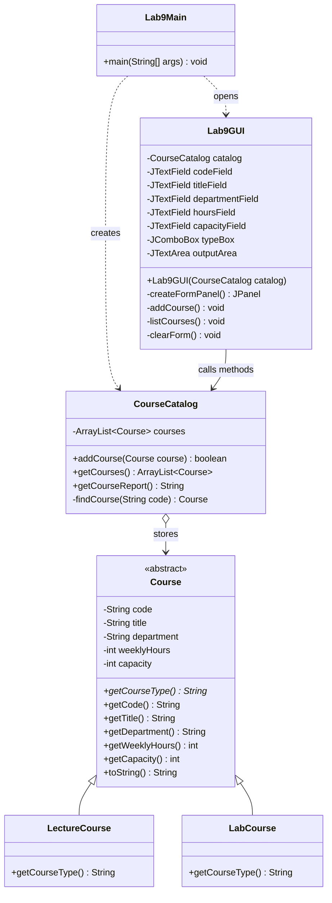
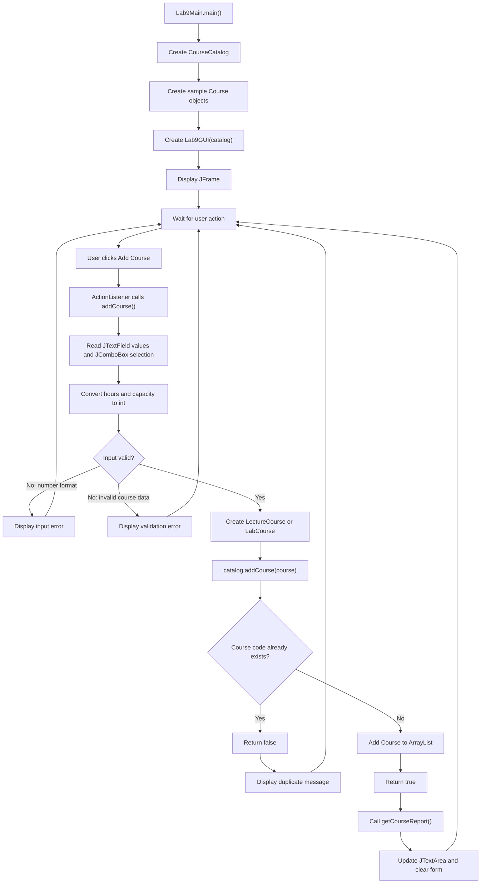

# Programming 2 — Lecture 16: Java GUI with Swing

> This lecture introduces the basic ideas behind a Java Graphical User Interface (GUI), then walks through the same class structure and event flow used in **Lab 9 — Building a College Course GUI**. The goal is to understand how a button click travels from the GUI to the application classes and back to the screen.

## Learning objectives

By the end of this lecture, you should be able to:

- explain the difference between a console program and an event-driven GUI;
- identify a window, container, component, event, and event listener;
- create a basic Swing window using `JFrame` and `JPanel`;
- use common Swing components such as `JLabel`, `JTextField`, `JButton`, `JComboBox`, and `JTextArea`;
- read information entered by a user;
- respond to a button click using an `ActionListener`;
- explain how a GUI class communicates with other Java classes;
- separate user-interface code from application/business logic;
- trace the Lab 9 Add Course and List Courses actions.

---

## 1. What is a GUI?

GUI means **Graphical User Interface**.

A console program normally communicates with the user through text:

```text
Java program → console output
Java program ← keyboard input
```

A GUI lets the user interact with visual elements:

- windows;
- buttons;
- labels;
- text fields;
- combo boxes;
- text areas;
- menus and lists.

In Java, we can build desktop GUIs using **Swing**.

A GUI is usually **event-driven**. Instead of executing one long sequence of questions and answers, the program creates the interface and waits for the user to do something.

Examples of events:

```text
The user clicks Add Course.
The user clicks List Courses.
The user selects LAB from a combo box.
The user closes the window.
```

When an event happens, Java executes code that was registered to respond to that event.

---

## 2. The five basic GUI ideas

Before looking at the Lab 9 code, understand these five terms.

| Term | Meaning | Lab 9 example |
|---|---|---|
| Window | The main application window | `JFrame` |
| Container | An object that holds other GUI components | `JPanel` |
| Component | A visible control or display element | `JButton`, `JTextField`, `JLabel` |
| Event | An action that happens in the interface | Clicking Add Course |
| Event listener | Code registered to respond to an event | `ActionListener` |

### 2.1 Window — `JFrame`

A `JFrame` is the main application window.

```java
JFrame frame = new JFrame("Programming 2");

frame.setSize(500, 300);
frame.setDefaultCloseOperation(JFrame.EXIT_ON_CLOSE);
frame.setVisible(true);
```

Important methods:

- `setSize(width, height)` sets the window dimensions.
- `setDefaultCloseOperation(...)` determines what happens when the user closes the window.
- `setVisible(true)` makes the window appear.

If `setVisible(true)` is missing, the window may be created but the user will not see it.

### 2.2 Container — `JPanel`

A container holds and organizes components.

```java
JPanel panel = new JPanel();

JLabel label = new JLabel("Course code:");
JTextField field = new JTextField(12);
JButton button = new JButton("Add Course");

panel.add(label);
panel.add(field);
panel.add(button);

frame.add(panel);
```

The panel is placed inside the frame. The label, text field, and button are placed inside the panel.

### 2.3 Components

These are the main components used in Lab 9.

| Component | Purpose | Example |
|---|---|---|
| `JLabel` | Displays text | `"Course code:"` |
| `JTextField` | Allows one-line text input | Course code or weekly hours |
| `JButton` | Lets the user request an action | `"Add Course"` |
| `JComboBox<String>` | Lets the user select one option | `"LECTURE"` or `"LAB"` |
| `JTextArea` | Displays multiple lines of text | Course catalogue report |
| `JScrollPane` | Adds scrolling to a component | Scrollable course report |

A component must be placed inside a container to appear in the interface.

---

## 3. Create a small Swing form

The following example creates a window with a label, a text field, and a button.

```java
import javax.swing.*;
import java.awt.*;

public class StudentForm {

    public static void main(String[] args) {

        JFrame frame = new JFrame("Student Form");
        JPanel panel = new JPanel();

        JLabel label = new JLabel("Student name:");
        JTextField nameField = new JTextField(15);
        JButton button = new JButton("Submit");

        panel.add(label);
        panel.add(nameField);
        panel.add(button);

        frame.add(panel);

        frame.setSize(400, 150);
        frame.setDefaultCloseOperation(JFrame.EXIT_ON_CLOSE);
        frame.setVisible(true);
    }
}
```

At this stage, the button is visible, but it does not do anything. To make it respond, we need an event listener.

---

## 4. Events and `ActionListener`

An **event** is something that happens while the user interacts with the GUI.

For a button, the common event is a click.

An **event listener** is code that waits for a particular event and responds when it occurs.

```java
button.addActionListener(e -> {
    System.out.println("Button clicked!");
});
```

Read this statement from left to right:

1. `button` is the button object.
2. `addActionListener(...)` registers code that should run when the button is activated.
3. `e -> { ... }` is a lambda expression representing the event-handling code.
4. The statements inside `{ ... }` execute after the button is clicked.

The event handler does not run simply because Java reaches this line. The line registers the handler. The handler runs later, when the user clicks the button.

### 4.1 Update a label after a click

```java
JLabel status = new JLabel("Off");
JButton button = new JButton("Turn On");

button.addActionListener(e -> {
    status.setText("On");
});
```

The sequence is:

```text
The window appears
       ↓
The program waits
       ↓
The user clicks Turn On
       ↓
The ActionListener executes
       ↓
The label changes to On
```

### 4.2 Read text entered by the user

A `JTextField` stores the text entered by the user.

```java
String name = nameField.getText();
```

To change or clear a text field:

```java
nameField.setText("New value");
nameField.setText("");
```

Remember that `getText()` returns a `String`, even when the user enters digits.

If the application needs an integer, convert the text:

```java
int hours = Integer.parseInt(hoursField.getText().trim());
```

If the text is not a valid integer, Java throws `NumberFormatException`. A GUI should catch that exception and display a useful message rather than terminating unexpectedly.

---

## 5. The big picture: how a GUI coordinates with other Java classes

A useful GUI application is not one enormous class. Different classes have different responsibilities.

In Lab 9, the responsibilities are:

| Class | Responsibility |
|---|---|
| `Lab9Main` | Creates the application objects and opens the GUI |
| `Lab9GUI` | Displays components, reads user input, handles button events, and updates the screen |
| `CourseCatalog` | Stores courses and applies catalogue rules, including duplicate checking |
| `Course` | Defines the common data and behaviour shared by courses |
| `LectureCourse` | Represents a lecture course |
| `LabCourse` | Represents a laboratory course |

### 5.1 Class relationship diagram

This UML-style diagram shows the main classes and their relationships.



Notice the separation:

- The GUI knows which catalogue it should use.
- The catalogue knows how to store and check courses.
- The catalogue does not need to know anything about buttons, text fields, or windows.
- `LectureCourse` and `LabCourse` inherit the shared information from `Course`.

This is the same object-oriented design idea used in your Assignment 3: each class has a clear responsibility, and objects communicate through methods.

### 5.2 Event and method-call flow diagram

The following diagram shows what happens when a user clicks **Add Course**.



**Important:** The GUI does not directly add an object to the `ArrayList`. It calls `catalog.addCourse(course)`. The `CourseCatalog` class owns the collection and applies the duplicate rule. This prevents the GUI from becoming responsible for all application logic.

---

## 6. Walk through the Lab 9 solution

Now connect the ideas to the actual Java files.

### 6.1 `Lab9Main.java` — start the application

```java
public class Lab9Main {
    public static void main(String[] args) {
        CourseCatalog catalog = new CourseCatalog();

        catalog.addCourse(new LectureCourse(
                "420-SN1", "Programming in Science", "CST", 3, 30));

        catalog.addCourse(new LabCourse(
                "420-LA1", "Programming Lab", "CST", 2, 24));

        SwingUtilities.invokeLater(() -> {
            Lab9GUI gui = new Lab9GUI(catalog);
            gui.setVisible(true);
        });
    }
}
```

What happens?

1. A `CourseCatalog` object is created.
2. Two sample course objects are created and added to the catalogue.
3. A `Lab9GUI` object is created and receives the catalogue through its constructor.
4. `setVisible(true)` displays the window.

Why pass `catalog` to the GUI constructor?

Because the GUI needs to ask the catalogue to add courses and produce reports. Passing the object gives the GUI access to the same catalogue that stores the courses.

`SwingUtilities.invokeLater(...)` schedules the GUI creation on Swing's Event Dispatch Thread. For this introductory lab, remember the practical rule: create and update Swing interfaces through this event-dispatch mechanism.

### 6.2 `Course.java` — common course information

```java
public abstract class Course {
    private final String code;
    private final String title;
    private final String department;
    private final int weeklyHours;
    private final int capacity;

    public Course(String code, String title, String department,
                  int weeklyHours, int capacity) {
        // validate and initialize the fields
    }

    public abstract String getCourseType();
}
```

This is an abstract superclass. It stores information shared by both lecture and lab courses.

The constructor validates the required text fields and ensures weekly hours and capacity are positive.

The `final` fields cannot be reassigned after the object is constructed. This is useful for course identity and basic course information in this lab.

### 6.3 `LectureCourse.java` and `LabCourse.java` — inheritance and polymorphism

```java
public class LectureCourse extends Course {

    public LectureCourse(String code, String title, String department,
                         int weeklyHours, int capacity) {
        super(code, title, department, weeklyHours, capacity);
    }

    @Override
    public String getCourseType() {
        return "Lecture";
    }
}
```

`LabCourse` follows the same structure but returns `"Lab"`.

The catalogue can store both types using one collection:

```java
private final ArrayList<Course> courses = new ArrayList<>();
```

This is polymorphism. The collection's element type is `Course`, but the actual objects can be `LectureCourse` or `LabCourse`.

When `toString()` calls `getCourseType()`, Java executes the overridden method belonging to the actual object.

### 6.4 `CourseCatalog.java` — application logic

This class owns the collection:

```java
private final ArrayList<Course> courses = new ArrayList<>();
```

Its `addCourse` method checks the course and prevents duplicate course codes:

```java
public boolean addCourse(Course course) {
    if (course == null) {
        throw new IllegalArgumentException("Course cannot be null.");
    }

    if (findCourse(course.getCode()) != null) {
        return false;
    }

    courses.add(course);
    return true;
}
```

There are two different outcomes:

| Situation | Result |
|---|---|
| Course is `null` | Throws `IllegalArgumentException` |
| Course code is already registered | Returns `false` |
| Course is valid and new | Adds it and returns `true` |

The search is case-insensitive. For example, `420-SN1` and `420-sn1` are treated as the same course code.

The GUI does not need to know how the duplicate search works. It only needs to check the returned boolean.

The class also provides:

```java
public String getCourseReport()
```

This method builds a readable report. The GUI can display the report without implementing the report formatting itself.

It also provides:

```java
public ArrayList<Course> getCourses() {
    return new ArrayList<>(courses);
}
```

This returns a **defensive copy**. A caller can modify the returned list without directly changing the catalogue's internal list.

### 6.5 `Lab9GUI.java` — the interface and event handlers

The GUI class extends `JFrame`:

```java
public class Lab9GUI extends JFrame {
    private final CourseCatalog catalog;

    private final JTextField codeField = new JTextField(12);
    private final JTextField titleField = new JTextField(18);
    private final JComboBox<String> typeBox =
            new JComboBox<>(new String[]{"LECTURE", "LAB"});
    private final JTextArea outputArea = new JTextArea(13, 60);
}
```

The GUI keeps a reference to the catalogue and creates the controls used by the user.

The `createFormPanel()` method creates the panel, places the labels and fields, and creates the buttons.

The event listeners are registered here:

```java
addButton.addActionListener(e -> addCourse());
listButton.addActionListener(e -> listCourses());
```

These lines do not immediately add or list courses. They register methods to be called later when the user clicks the corresponding button.

### 6.6 Follow the Add Course button

The `addCourse()` method is the most important method in Lab 9.

**Step 1 — Read the text fields**

```java
String code = codeField.getText().trim();
String title = titleField.getText().trim();
String department = departmentField.getText().trim();
```

**Step 2 — Convert numeric input**

```java
int hours = Integer.parseInt(hoursField.getText().trim());
int capacity = Integer.parseInt(capacityField.getText().trim());
```

The text fields return strings. `Integer.parseInt` converts valid integer text to an `int`.

**Step 3 — Create the correct object**

```java
Course course;

if ("LECTURE".equals(type)) {
    course = new LectureCourse(
            code, title, department, hours, capacity);
} else {
    course = new LabCourse(
            code, title, department, hours, capacity);
}
```

The reference variable has type `Course`, but the object is one of its concrete subclasses.

**Step 4 — Ask the catalogue to add it**

```java
boolean added = catalog.addCourse(course);
```

The GUI delegates the registration rule to the catalogue.

**Step 5 — Respond to the result**

```java
if (added) {
    outputArea.setText("Course added successfully:\n"
            + course + "\n\n"
            + catalog.getCourseReport());
    clearForm();
} else {
    outputArea.setText(
            "A course with code " + code + " is already registered.");
}
```

The GUI displays the result and clears the fields only after a successful addition.

### 6.7 Handle invalid input

The user might type `"three"` into the weekly hours field.

This statement:

```java
Integer.parseInt("three");
```

throws `NumberFormatException`.

The GUI handles it:

```java
catch (NumberFormatException ex) {
    outputArea.setText(
            "Weekly hours and capacity must be whole numbers.");
}
```

The `Course` constructor can also throw `IllegalArgumentException` if required text is blank or numeric values are not positive:

```java
catch (IllegalArgumentException ex) {
    outputArea.setText("Invalid course: " + ex.getMessage());
}
```

This is connected to the exception-handling ideas from Assignment 3. The GUI catches errors and presents a useful message instead of allowing an invalid action to crash the application.

### 6.8 Follow the List Courses button

The List Courses event is intentionally short:

```java
private void listCourses() {
    outputArea.setText(catalog.getCourseReport());
}
```

The GUI asks the catalogue for a report and places the returned string in the text area.

The GUI does not need to loop through every course or build the report itself.

---

## 7. The complete responsibility split

When you design a GUI application, ask: **Which class should do this work?**

| Work | Correct class in Lab 9 |
|---|---|
| Display the window | `Lab9GUI` |
| Display labels, fields, buttons, and text area | `Lab9GUI` |
| Read the text fields after a click | `Lab9GUI` |
| Register and execute GUI event handlers | `Lab9GUI` |
| Validate the course's required data | `Course` constructor |
| Store the courses | `CourseCatalog` |
| Check for duplicate course codes | `CourseCatalog` |
| Build the course report | `CourseCatalog` |
| Define common course data | `Course` |
| Define the lecture-specific type | `LectureCourse` |
| Define the lab-specific type | `LabCourse` |
| Create the catalogue and open the window | `Lab9Main` |

A useful rule:

> The GUI handles interaction. The model classes represent the data. The catalogue or system class manages the application rules.

This separation makes the application easier to test, debug, extend, and reuse.

---

## 8. Common GUI mistakes

### Mistake 1: Forgetting to display the window

```java
frame.setVisible(true);
```

Without this call, the window is not shown.

### Mistake 2: Forgetting the close operation

```java
frame.setDefaultCloseOperation(JFrame.EXIT_ON_CLOSE);
```

This tells the application to terminate when the user closes the main window.

### Mistake 3: Expecting the event handler to run immediately

```java
button.addActionListener(e -> {
    System.out.println("Clicked");
});
```

This registers the handler. It runs when the user activates the button.

### Mistake 4: Putting all business logic in the GUI

Avoid placing duplicate checking, collection management, and report generation directly inside the button listener.

Instead, call methods such as:

```java
catalog.addCourse(course);
catalog.getCourseReport();
```

### Mistake 5: Forgetting that text fields return strings

Use `Integer.parseInt(...)` or another suitable conversion method, and handle invalid input.

### Mistake 6: Building a GUI in the wrong place

For Swing applications, create the interface using:

```java
SwingUtilities.invokeLater(() -> {
    Lab9GUI gui = new Lab9GUI(catalog);
    gui.setVisible(true);
});
```

---

## 9. Run Lab 9 in IntelliJ IDEA

1. Extract the Lab 9 solution folder.
2. In IntelliJ IDEA, choose **File → Open** and select the extracted folder.
3. Set the Project SDK to an installed JDK (JDK 8 or later).
4. Open `Lab9Main.java`.
5. Click the green Run icon beside the `main` method.
6. The College Course Catalogue window should appear with two sample courses.

To run the catalogue logic checks, open `CourseCatalogTest.java` and run its `main` method.

Expected output:

```text
CourseCatalog checks passed: 5/5
```

The project uses standard Java Swing and the Java Collections Framework. It does not require Maven, Gradle, or external libraries.

---

# Practice

## Practice 1 — Identify the GUI parts

For each item, identify whether it is a window, container, component, event, or event listener.

1. `JFrame`
2. `JPanel`
3. `JTextField`
4. Clicking the Add Course button
5. `button.addActionListener(...)`

## Practice 2 — Understand the event listener

What does this code do?

```java
button.addActionListener(e -> {
    status.setText("On");
});
```

At what point does the code inside the braces execute?

## Practice 3 — Trace the Add Course action

Put these steps in the correct order:

- `CourseCatalog` checks whether the code already exists.
- The user clicks Add Course.
- `Lab9GUI` reads the text fields.
- `CourseCatalog` adds the course to its `ArrayList`.
- `Lab9GUI` displays the updated report.
- `Lab9GUI` creates a `LectureCourse` or `LabCourse`.

## Practice 4 — Choose the correct class

Which class should be responsible for each task?

1. Checking for a duplicate course code.
2. Displaying an error message in the text area.
3. Storing all courses in an `ArrayList<Course>`.
4. Returning `"Lecture"` from `getCourseType()`.
5. Responding to the Add Course button click.

## Practice 5 — Understand the return value

What is the difference between these two results from `catalog.addCourse(course)`?

```java
true
```

and:

```java
false
```

Does `false` mean that an exception was thrown?

## Practice 6 — Handle invalid input

A user enters `"two"` for weekly hours.

1. Which Java statement attempts to convert the value?
2. Which exception can occur?
3. Which class should display the error message?
4. Should the application close?

## Practice 7 — Design extension

The LEA Final Project will also manage faculty and teaching assignments.

Suggest:

1. Two additional buttons that could be added to the GUI.
2. Which application class should manage teaching assignments?
3. What information should the GUI collect when assigning a faculty member to a course?
4. Why should workload validation be implemented outside the GUI event handler?

---

## Key takeaways

- A Swing GUI is event-driven: it waits for user actions.
- `JFrame` is the window; `JPanel` is a container; components are controls such as buttons and text fields.
- `addActionListener` registers code to run when an event occurs.
- A GUI event handler reads user input, calls application methods, and updates the screen.
- The GUI should not own the application's business rules or data collections.
- In Lab 9, `CourseCatalog` stores courses and checks duplicate codes; `Course` and its subclasses represent course data.
- The same design will scale to the LEA Final Project: GUI → system/controller class → domain objects and collections → result returned to the GUI.
