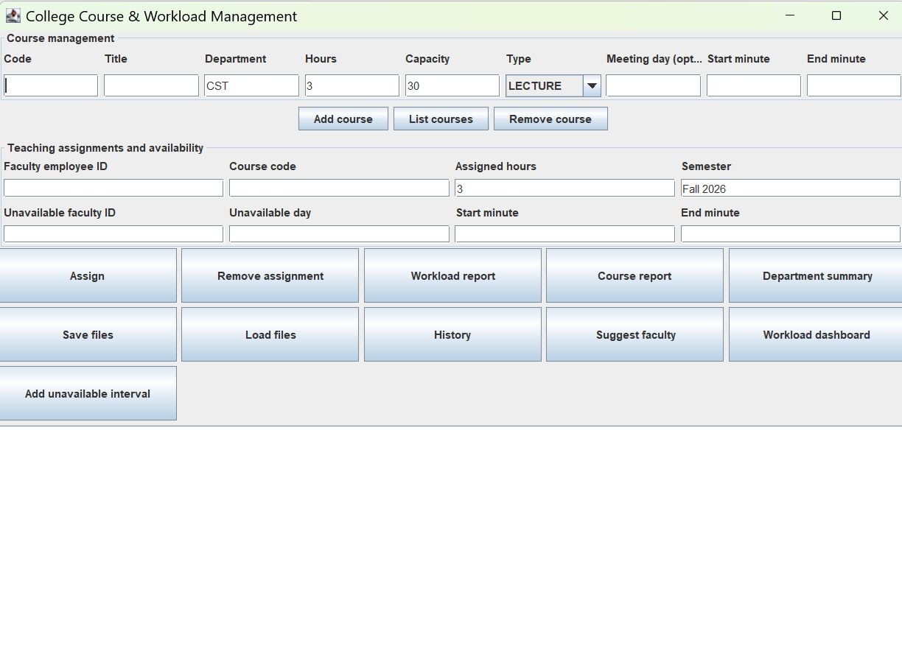
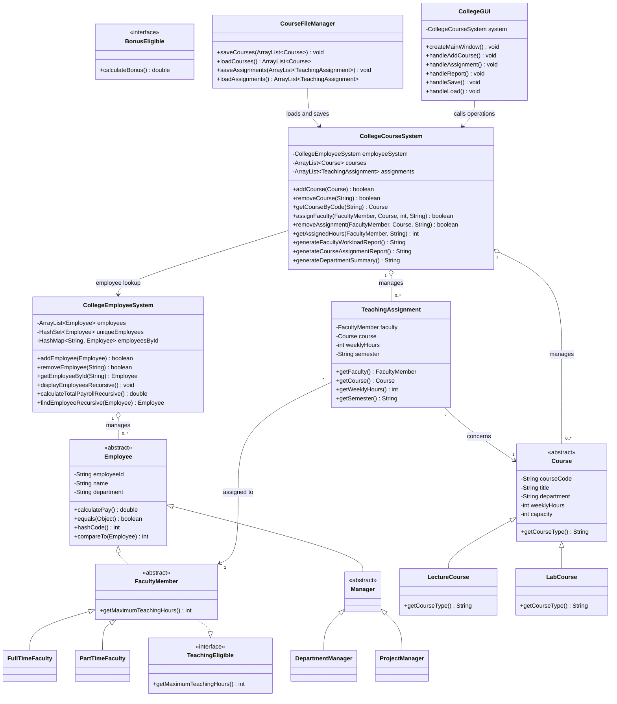

# Programming 2 --- Final Project

## College Course & Workload Management System

**Duration:** 3 weeks (approximately 10--12 hours)\
**Group size:** 1--4 students\
**Assessment:** 100 marks + up to 15 bonus marks

------------------------------------------------------------------------

## 1. Project overview

Continue developing your **College Employee Management System** from
Assignments 2 and 3. The college now needs a system to manage courses,
assign faculty members to courses, and monitor teaching workloads.

Extend your existing application into a **College Course & Workload
Management System**. Administrators must be able to create and manage
courses, assign eligible faculty members, view workload reports, and
save/load application data using text files. The application must
include a simple Java Swing GUI.

This is an extension of your previous work, not a new application. Reuse
your employee hierarchy and existing functionality. 

## 2. Required features

### A. Course management

Create an **abstract class** named `Course` with suitable fields:

-   `courseCode` (for example, `420-SN1-RE`)
-   `title`
-   `department`
-   `weeklyHours`
-   `capacity`

Create two concrete subclasses:

-   `LectureCourse`
-   `LabCourse`

Each subclass must override `getCourseType()` to return `"Lecture"` or
`"Lab"` respectively.

The system must allow an administrator to:

1.  Add a course.
2.  Display all courses.
3.  Search for a course by course code.
4.  Remove a course, provided it has no teaching assignments.

Course codes must be unique. Validate required text fields and ensure
that weekly hours and capacity are positive. Invalid course information
must be handled without crashing the application.

### B. Faculty eligibility and teaching assignments

Create a `TeachingEligible` interface with the method:

``` java
int getMaximumTeachingHours();
```

Modify the existing abstract `FacultyMember` class so that it implements
`TeachingEligible`. The concrete faculty classes inherit this
implementation contract. Provide an appropriate maximum weekly workload
for each faculty type. For this project, use **18 hours for
FullTimeFaculty** and **9 hours for PartTimeFaculty**.

Create a `TeachingAssignment` class containing:

-   A `FacultyMember` reference.
-   A `Course` reference.
-   Assigned weekly teaching hours.
-   Semester/term (for example, `Fall 2026`).

The system must allow an administrator to:

1.  Assign a faculty member to a course.
2.  Remove a teaching assignment.
3.  Display the courses assigned to a selected faculty member.
4.  Display the faculty members assigned to a selected course.

Apply these rules:

-   Only a `FacultyMember` can receive a teaching assignment.
-   The same faculty member cannot be assigned to the same course twice
    in the same semester.
-   Assigned hours must be positive and must not exceed the course's
    weekly hours.
-   A faculty member's total assigned hours for a semester must not
    exceed their maximum teaching hours.
-   A course cannot be removed while it has an assignment.
-   Invalid requests must produce a clear message; they must not leave
    the system in a partially updated state.

Use the `getMaximumTeachingHours()` method through the
`TeachingEligible` interface. Do not write separate workload formulas
for full-time and part-time faculty.

### C. Workload reports

Implement all three reports:

1.  **Faculty workload report:** For each faculty member, display their
    name, employee ID, assigned courses, total weekly assigned hours,
    maximum permitted hours, and remaining hours.
2.  **Course assignment report:** For each course, display its code,
    title, type, and assigned faculty members.
3.  **Department summary:** For each department, display the number of
    courses and total assigned teaching hours.

Use collections and loops to process the records. Format the output so
that it is easy to read. You may display reports in a `JTextArea` or
another suitable Swing component.

### D. Text-file input and output

Use the techniques from Lectures 13 and 14. Do not use a database or a
serialization library.

Your application must:

-   Save course records to a text or CSV file.
-   Save teaching-assignment records to a text or CSV file.
-   Load saved records when the application starts.
-   Use `Scanner` to read records and `FileWriter` or `BufferedWriter`
    to write them.
-   Use try-with-resources to close file resources.
-   Handle a missing file and malformed records without crashing.
-   Avoid loading duplicate courses or duplicate assignments.

Use a predictable record format. For example:

``` text
# Courses: type,code,title,department,hours,capacity
LECTURE,420-SN1-RE,Programming in Science,CST,3,30
LAB,420-PR2-RE,Programming Lab,CST,2,24
```

For assignments, use a format such as:

``` text
# Assignments: employeeId,courseCode,hours,semester
E101,420-SN1-RE,3,Fall 2026
E105,420-PR2-RE,2,Fall 2026
```

You may assume that text fields in these files do not contain commas.
Skip or report malformed records and continue loading the remaining
valid records. Document how your program handles a bad line. Load
courses before assignments because assignments refer to existing
courses.

**Important:** An assignment file stores employee IDs, not complete
employee objects. When loading assignments, find the faculty member
through the existing employee system (for example, `getEmployeeById`)
and verify that the result is a `FacultyMember` before creating the
assignment. Do not create a second copy of an employee.

### E. Swing GUI

Build a simple functional GUI using the Swing components covered in
Lecture 16.

Your GUI must include:

-   A main `JFrame`.
-   A sensible layout using one or more `JPanel` containers.
-   Course-management controls using components such as `JLabel`,
    `JTextField`, and `JButton`.
-   Teaching-assignment controls.
-   A way to display reports and operation messages, such as a
    `JTextArea` and `JLabel`.
-   Event handlers for the main operations.

At minimum, users must be able to add a course, assign a faculty member
to a course, display a report, save data, and load data through the GUI.

Use `ActionListener` or the lambda-based `addActionListener` approach
from the lecture. An event handler should collect input, call a method
in your application-logic class, and display the result. **Do not put
the workload calculations, validation rules, or file-processing
algorithms directly inside a button listener.**

The GUI does not need elaborate styling. Correct behaviour, clear
prompts, and a sensible layout are more important.
#### Expected GUI output:


## 3. Provided UML class design

The following UML is the recommended architecture for this project. Use
it as the starting point for your implementation and update it only when
a change is necessary. Your submitted UML must match your actual Java
code.



### How to interpret the UML
```
  -----------------------------------------------------------------------
  Design decision                     Meaning
  ----------------------------------- -----------------------------------
  `Employee` is abstract              Retain the existing employee
                                      hierarchy.

  `FacultyMember` implements          Faculty members share a contract
  `TeachingEligible`                  for determining maximum teaching
                                      hours.

  `Course` is abstract                Every course created in this
                                      project must be a lecture or a lab.

  `LectureCourse` and `LabCourse`     Both inherit common course
                                      attributes and override
                                      `getCourseType()`.

  `TeachingAssignment`                Represents the relationship between
                                      one faculty member and one course
                                      for a particular semester.

  `CollegeCourseSystem`               Manages courses, assignments,
                                      validation, and reports.

  `CourseFileManager`                 Separates file input/output from
                                      the business logic.

  `CollegeGUI`                        Handles user interaction and calls
                                      methods in the management class.
  -----------------------------------------------------------------------
```
**Assignment 3 compatibility:** `BonusEligible` is shown because it is
part of the existing project. Preserve the implementation relationships
already present in your Assignment 3 code and UML. Do not change bonus
eligibility as part of this project.

### Five important OOP design choices

1.  **Why is `Course` abstract?** A generic course should not be created
    directly. Each course must have a specific type, while common
    attributes and behaviour belong in the superclass.
2.  **Why is `TeachingEligible` an interface?** The assignment logic can
    use a common contract to obtain a faculty member's maximum workload
    without depending on the concrete faculty subclass.
3.  **Why does `TeachingAssignment` refer to both `FacultyMember` and
    `Course`?** It connects existing objects. It should not create
    duplicate employee or course records.
4.  **Why does `CollegeCourseSystem` store an
    `ArrayList<TeachingAssignment>`?** The system must manage multiple
    assignments, search and remove them, and process them for reports.
5.  **Why is the GUI separate from the management class?** The same
    business methods should work when called from the GUI, a test
    driver, or another Java class.

## 4. Design and programming requirements

Your submitted application must:

1.  Preserve the Assignment 2/3 employee hierarchy and existing
    features, including polymorphic `calculatePay()`, `BonusEligible`,
    natural ordering, the pay comparator, and the Assignment 3
    collection/identity functionality.
2.  Include the abstract `Course` class and its `LectureCourse` and
    `LabCourse` subclasses.
3.  Include the `TeachingEligible` interface, implemented by
    `FacultyMember`.
4.  Include the `TeachingAssignment` class and a management class for
    courses and assignments.
5.  Use encapsulation, inheritance, abstraction, polymorphism, method
    overriding, and at least one overloaded method.
6.  Use `ArrayList` or other course collections covered in class.
7.  Include validation and appropriate exception handling. You may
    create a custom unchecked exception for invalid courses or
    assignments.
8.  Implement a recursive course-display method in
    `CollegeCourseSystem`, using a private index-based helper. This
    extends Lecture 11 without repeating the Assignment 3 recursive
    payroll or employee-search tasks.
9.  Include unit tests for important business-logic methods and a
    driver/test class.
10. Document important classes and methods with block comments and
    follow Java naming and formatting conventions.
11. Keep GUI code separate from business logic so that the logic can be
    tested without opening the GUI.

Use only Java language features and libraries appropriate to the course
material. Do not use databases, networking, JavaFX, external GUI
frameworks, streams, or other advanced techniques that have not been
taught.

## 5. Suggested project structure

You may adapt this structure to your existing Assignment 3 project:

``` text
src/
  Employee.java                 (existing)
  FacultyMember.java            (modify)
  FullTimeFaculty.java          (existing/modify)
  PartTimeFaculty.java          (existing/modify)
  ... other existing employee classes
  CollegeEmployeeSystem.java    (existing)
  TeachingEligible.java         (new interface)
  Course.java                   (new abstract class)
  LectureCourse.java            (new)
  LabCourse.java                (new)
  TeachingAssignment.java       (new)
  CollegeCourseSystem.java      (new management class)
  CourseFileManager.java        (new file input/output class)
  Main.java                     (driver)
  CollegeGUI.java               (new Swing GUI)
```

You may combine file-handling methods into your management class if your
design remains clear. You do not need to create a separate class for
every small task.

## 6. Starter code and integration guidance

The following examples show the expected design direction. Adapt names
and constructors to match your Assignment 3 solution. These are starting
points, not a complete solution.

### A. Add the interface to the existing faculty hierarchy

``` java
public interface TeachingEligible {
    int getMaximumTeachingHours();
}
```

Modify the existing abstract class:

``` java
public abstract class FacultyMember extends Employee
        implements TeachingEligible {

    // Keep your existing FacultyMember fields and constructors.

    // Concrete faculty classes must provide this method.
    @Override
    public abstract int getMaximumTeachingHours();
}
```

Then implement the method in the concrete faculty classes:

``` java
// Inside FullTimeFaculty
@Override
public int getMaximumTeachingHours() {
    return 18;
}

// Inside PartTimeFaculty
@Override
public int getMaximumTeachingHours() {
    return 9;
}
```

Keep all existing constructors and methods. Do not replace your
Assignment 3 employee design with these short examples.

### B. Abstract course hierarchy

``` java
public abstract class Course {
    private String courseCode;
    private String title;
    private String department;
    private int weeklyHours;
    private int capacity;

    public Course(String courseCode, String title, String department,
                  int weeklyHours, int capacity) {
        // Validate the data, then initialize the fields.
        this.courseCode = courseCode;
        this.title = title;
        this.department = department;
        this.weeklyHours = weeklyHours;
        this.capacity = capacity;
    }

    public abstract String getCourseType();

    public String getCourseCode() {
        return courseCode;
    }

    public String getTitle() {
        return title;
    }

    public String getDepartment() {
        return department;
    }

    public int getWeeklyHours() {
        return weeklyHours;
    }

    public int getCapacity() {
        return capacity;
    }
}
```

A concrete subclass overrides the abstract method:

``` java
public class LectureCourse extends Course {

    public LectureCourse(String code, String title, String department,
                         int hours, int capacity) {
        super(code, title, department, hours, capacity);
    }

    @Override
    public String getCourseType() {
        return "Lecture";
    }
}
```

Create `LabCourse` in the same way, returning `"Lab"` from
`getCourseType()`.

### C. Teaching assignment

``` java
public class TeachingAssignment {
    private FacultyMember faculty;
    private Course course;
    private int weeklyHours;
    private String semester;

    public TeachingAssignment(FacultyMember faculty, Course course,
                              int weeklyHours, String semester) {
        // Validate references, hours, and semester.
        this.faculty = faculty;
        this.course = course;
        this.weeklyHours = weeklyHours;
        this.semester = semester;
    }

    public FacultyMember getFaculty() {
        return faculty;
    }

    public Course getCourse() {
        return course;
    }

    public int getWeeklyHours() {
        return weeklyHours;
    }

    public String getSemester() {
        return semester;
    }
}
```

### D. Workload calculation using the interface

The management class should calculate the current assigned hours for a
faculty member in a selected semester. Then compare the proposed
assignment with the maximum supplied by the interface.

``` java
public int getAssignedHours(FacultyMember faculty, String semester) {
    int total = 0;

    for (TeachingAssignment assignment : assignments) {
        if (assignment.getFaculty().equals(faculty)
                && assignment.getSemester().equals(semester)) {
            total += assignment.getWeeklyHours();
        }
    }

    return total;
}
```

Before adding an assignment, check:

``` java
TeachingEligible eligible = faculty;

int currentHours = getAssignedHours(faculty, semester);

if (currentHours + requestedHours
        > eligible.getMaximumTeachingHours()) {
    throw new InvalidTeachingAssignmentException(
            "Faculty workload limit exceeded.");
}
```

You must also check that the course exists, the requested hours are
valid, and the faculty/course/semester combination is not already
assigned.

### E. Suggested method responsibilities

Use these method signatures as a guide. You may use equivalent names if
your design is clearly documented.

``` java
public boolean assignFaculty(
    FacultyMember faculty,
    Course course,
    int hours,
    String semester
);
```

``` java
public int getAssignedHours(
    FacultyMember faculty,
    String semester
);
```

``` java
public String generateFacultyWorkloadReport();
```

The `assignFaculty()` method should validate the request before changing
the assignment list. A failed assignment must not partially update the
system.

## 7. Deliverables

Submit one ZIP file containing:

**Deliverable 1 --- Design** - Updated UML class diagram (`.png` or
`.jpg`). - Pseudocode for two important methods, such as
`assignFaculty()` and `loadAssignments()`.

**Deliverable 2 --- Application** - All required `.java` source files. -
Any required data files. - A working Swing GUI. - A short README
explaining how to compile and run the application.

**Deliverable 3 --- Testing and documentation** - Unit tests for
important operations. - A driver/test class demonstrating the main
features. - A short contribution statement identifying each group
member's work.

Your UML must show the employee hierarchy, the new course hierarchy, the
`TeachingEligible` interface, `TeachingAssignment`, and the
relationships between the management classes.

## 8. Assessment

### Part A --- Submitted project: 40 marks

  Criterion                                                             Marks
  ------------------------------------------------------------------ --------
  UML, new classes, inheritance, abstraction, and interface design          8
  Course management and teaching-assignment operations                     10
  Workload validation and three reports                                     6
  Text-file input/output and exception handling                             6
  Swing GUI and event handling                                              6
  Unit tests, documentation, and code quality                               4
  **Total**                                                            **40**

### Part B --- Individual post-submission challenge: 60 marks

After the group project is submitted, each student completes an
individual programming challenge assigned by the instructor.

**Time:** Approximately 60 minutes.\
**Value:** 60 marks.

The challenge may require you to modify an existing method, implement an
additional condition, correct a logical error, add a small operation, or
explain and test part of your submitted application.

  Criterion                                            Marks
  ------------------------------------------------- --------
  Understanding and interpretation of the problem         10
  Correct implementation of the main requirement          20
  Extension 1                                             12
  Extension 2                                             10
  Testing, integration, and explanation                    8
  **Total**                                           **60**

The challenge will use concepts covered in class. You must be able to
explain your own code and demonstrate that your change works.

## 9. Optional creativity challenges --- up to 15 bonus marks

Choose optional features only after the required project is working.
Each feature is worth 5 marks. You may earn a maximum of 15 bonus marks.

  -----------------------------------------------------------------------
  Optional feature                                                  Bonus
  ------------------------------ ----------------------------------------
  **Course conflict detection:**                                        5
  Detect overlapping course      
  meeting times for the same     
  faculty member. You must add a 
  simple day/time field to the   
  necessary classes.             

  **Faculty availability:**                                             5
  Allow an administrator to      
  record unavailable days or     
  time slots and reject          
  conflicting assignments.       

  **Workload dashboard:**                                               5
  Display a graphical summary of 
  faculty workloads or           
  department teaching hours      
  using basic Swing components.  

  **Assignment history:** Keep a                                        5
  record of assignment additions 
  and removals and allow the     
  administrator to display the   
  history.                       

  **Faculty suggestions:**                                              5
  Suggest eligible faculty for a 
  course based on department and 
  remaining workload.            
  -----------------------------------------------------------------------

Bonus features must work with the application's actual data. Extra
buttons or hard-coded sample output do not count.

## 10. Final checklist

Before submitting, make sure that:

-   [ ] The existing Assignment 3 employee system still works.
-   [ ] `Course` is abstract and both course subclasses work.
-   [ ] `FacultyMember` implements `TeachingEligible`.
-   [ ] Workload limits are checked for the correct semester.
-   [ ] Duplicate assignments are rejected.
-   [ ] All three reports display correct information.
-   [ ] Courses and assignments can be saved and loaded.
-   [ ] Missing files and malformed records are handled safely.
-   [ ] The Swing GUI responds to button clicks.
-   [ ] GUI event handlers call separate business-logic methods.
-   [ ] Recursive course display works.
-   [ ] Unit tests and the driver demonstrate important cases.
-   [ ] UML and pseudocode match the submitted code.
-   [ ] Every group member understands the application.

**Remember:** The submitted group project is worth 40 marks. The
individual post-submission challenge is worth 60 marks. Your ability to
explain, modify, and test your own code matters as much as the completed
application.
